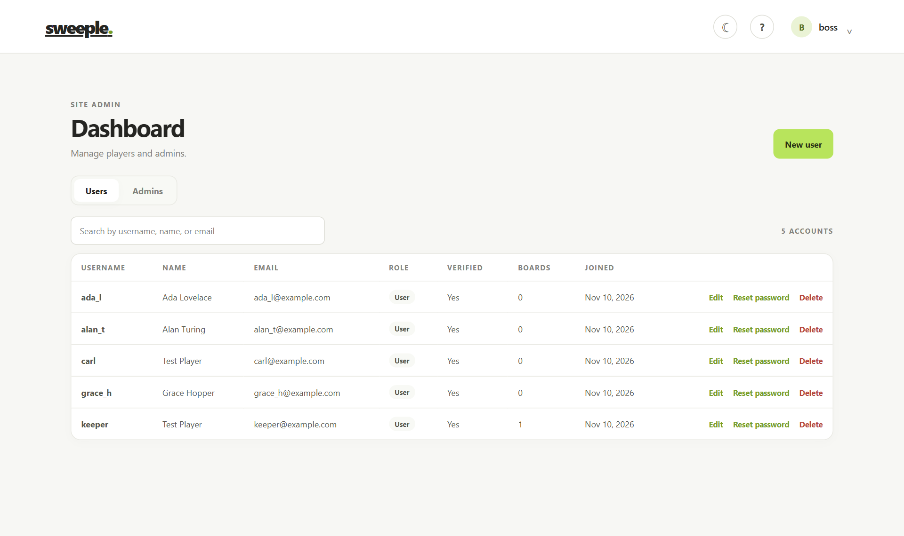
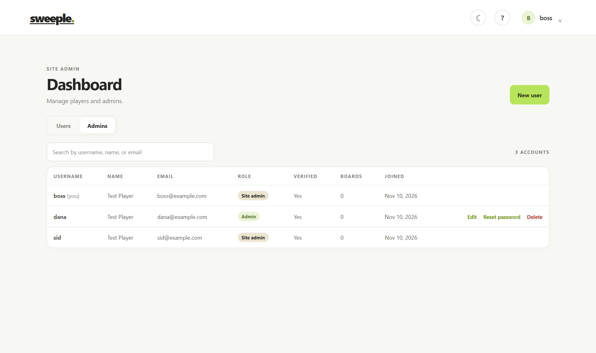
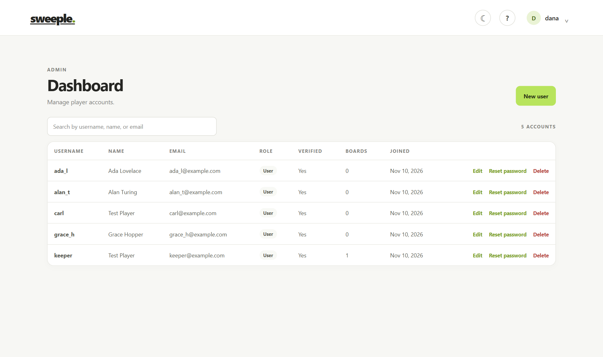
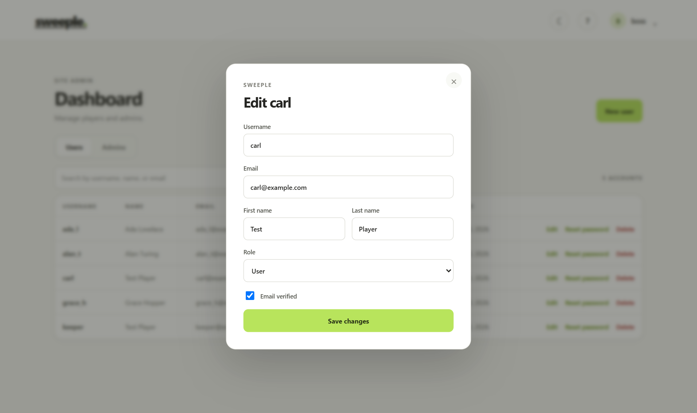
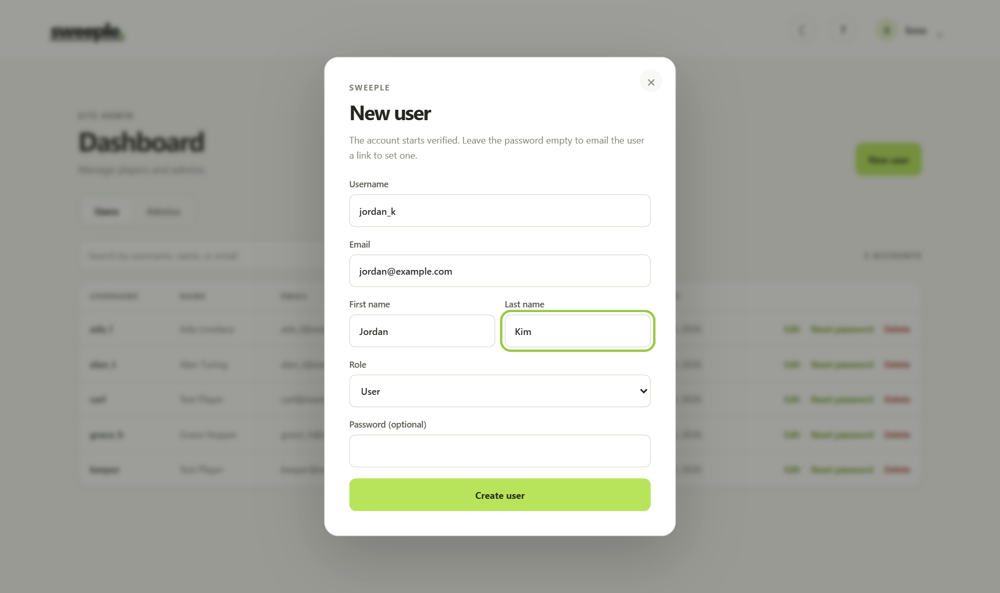
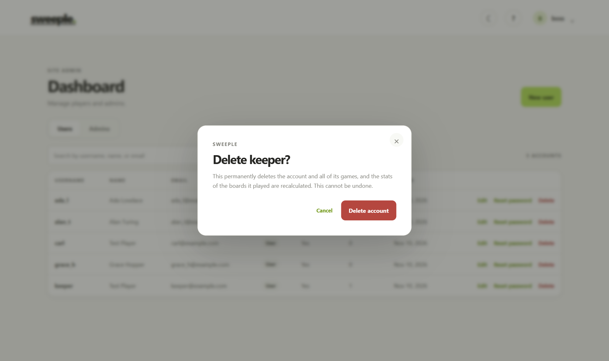
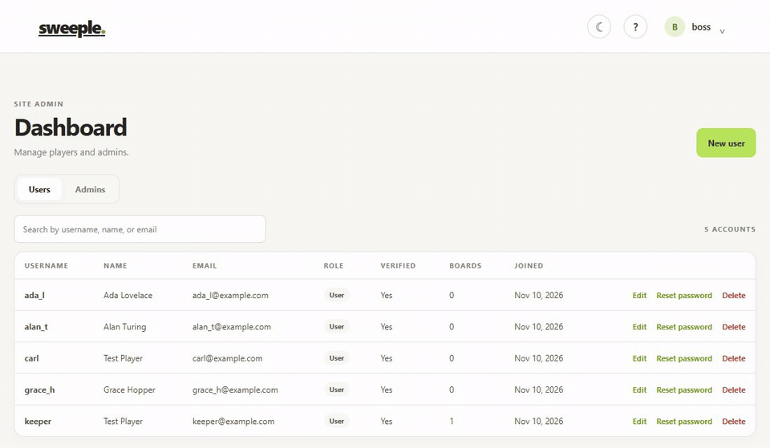

# Admin dashboard and roles

Some accounts can manage other accounts from the admin dashboard at `/admin`. What an account may do there depends on its role.

## Roles

Each user has a `role` (see [erd.md](erd.md)). Roles rank lowest to highest:

| Role | Who | Dashboard |
| --- | --- | --- |
| `user` | Every player (the default) | No access |
| `admin` | Moderators | **Users** list: create, edit, reset the password of, and delete regular users |
| `siteadmin` | Site owners | **Users** and **Admins** tabs: the same for users and admins, plus promoting a user to admin and demoting an admin to user |

### Permission matrix

| Action | admin | siteadmin |
| --- | --- | --- |
| See `user` accounts | ✓ | ✓ |
| See `admin` and `siteadmin` accounts | | ✓ (site admins are read-only) |
| Create an account with role `user` | ✓ | ✓ |
| Create an account with role `admin` | | ✓ |
| Edit, reset password of, or delete a `user` | ✓ | ✓ |
| Edit, reset password of, or delete an `admin` | | ✓ |
| Change a role between `user` and `admin` | | ✓ |
| Grant or remove `siteadmin` | | (only through `SITE_ADMIN_EMAILS` or `npm run set-role`) |
| Change or delete your own account | | |

The rules live in [backend/lib/roles.js](../backend/lib/roles.js). An account can manage another only when the target's role ranks below its own and the target is not itself. [client/src/auth/roles.ts](../client/src/auth/roles.ts) mirrors the rules so the client knows what to show, but the server checks every request again.

The role is read from the database on every admin request, not from the login token. Promoting or demoting someone therefore takes effect on their next request.

## Making the first site admin

Nobody can promote anyone until a site admin exists. There are two ways to create one.

### 1. `SITE_ADMIN_EMAILS` (recommended)

Set a comma-separated list of email addresses in the backend environment: `backend/.env`, or the root `.env` that Docker Compose reads.

```
SITE_ADMIN_EMAILS=owner@example.com,cofounder@example.com
```

- When the server starts, every **verified** account with a listed email becomes `siteadmin`.
- An account created later with a listed email gets `siteadmin` when it is created. That covers registering and the first GitHub or Google sign-in. It still has to verify its email before it can log in.
- Removing an email from the list does **not** demote the account. Use the script below.

### 2. `npm run set-role`

Sets any role directly in the database. It is also how you demote a site admin.

```bash
cd backend
npm run set-role -- <username or email> <user|admin|siteadmin>
```

With the local Docker Compose stack:

```bash
docker compose -f compose.dev.yaml exec backend npm run set-role -- alexrivera siteadmin
```

For production, use the active release's protected environment and immutable
image tag as documented in [deploy/README.md](../deploy/README.md#manage-a-production-role).

## Using the dashboard

1. Sign in as an admin or site admin. The account menu gets an **Admin** link.
2. **Search** matches username, email, first name, or last name. There are 20 accounts per page.
3. **New user** creates an account that starts verified. If you leave the password empty, the user gets an email with a link to set one. Site admins can choose the `admin` role here.
4. **Edit** changes the username, email, names, the "email verified" flag, and (for site admins) the role. A username or email that is already taken shows an error.
5. **Reset password** emails the user a password reset link, the same one "forgot password" sends.
6. **Delete** asks for confirmation, then removes the account and all of its games. The stats of every board the user played are recalculated without those games ([backend/lib/stats.js](../backend/lib/stats.js)).

Rows you cannot manage, such as site admins and your own row, show no actions.

### Screenshots

| Site admin: Users tab | Site admin: Admins tab |
| --- | --- |
|  |  |
| **Admin: users only, no tabs** | **Edit dialog with role** |
|  |  |
| **New user** | **Delete confirmation** |
|  |  |

Promoting a user to admin and back:


Creating a user, then deleting them:



The dashboard also has a dark mode ([screenshot](images/admin/admin-dark-mode.png)) and a phone layout ([screenshot](images/admin/admin-phone.png)). The Admin link in the account menu is shown in [this screenshot](images/admin/admin-account-menu.png).

## API

Every route requires `Authorization: Bearer <token>` from an admin or site admin. A missing or expired login gets 401, and a role that is too low gets `403 { error: 'Not allowed', code: 'FORBIDDEN' }`. The full description is in [backend/openapi.yaml](../backend/openapi.yaml) under the **Admin** tag, and the [Bruno collection](../bruno/) has an `Admin` folder.

| Method | Path | What it does |
| --- | --- | --- |
| GET | `/api/admin/users?q=&role=&page=&limit=` | Accounts you can see, sorted by username. `role` takes one role or a comma-separated list. The response is `{ users, total, page, limit }`. |
| GET | `/api/admin/users/:id` | One account |
| POST | `/api/admin/users` | Create an account from `{ username, email, firstName?, lastName?, role?, password? }`. Returns 201, or 409 if the username or email is taken. |
| PATCH | `/api/admin/users/:id` | Change any of `firstName`, `lastName`, `username`, `email`, `emailVerified`, `role` |
| POST | `/api/admin/users/:id/password-reset` | Email a password reset link |
| DELETE | `/api/admin/users/:id` | Delete the account and its games, then recompute board stats |

Each user in a response is the usual profile (`id`, names, `username`, `email`, `emailVerified`, `role`, `providers`, stats). It also has `createdAt`, `hasPassword` (false for GitHub- or Google-only accounts), and `manageable` (whether *you* may edit, reset, or delete it).

## Tests

- API: [backend/tests/admin.test.js](../backend/tests/admin.test.js) (`cd backend && npm test`).
- Manual: the `Admin/` folder of the [Bruno collection](../bruno/README.md#admin-requests-admin-folder).

## Not included yet

Editing game data is not part of the dashboard yet: boards (daily dates) and attempts (scores on a given day) are being migrated separately. When that work lands, it can reuse:

- `requireRole('siteadmin')` for a `/api/admin/boards` router,
- `recomputeBoardStats` and `recomputeUserStats` in `lib/stats.js`, to bring totals back in line after attempts are changed.
