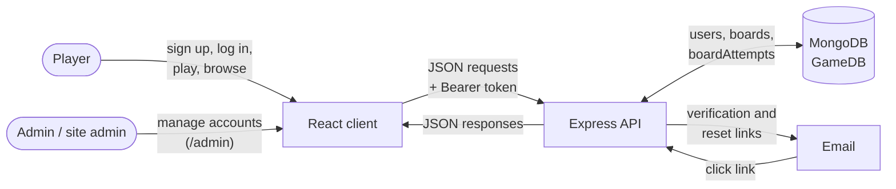
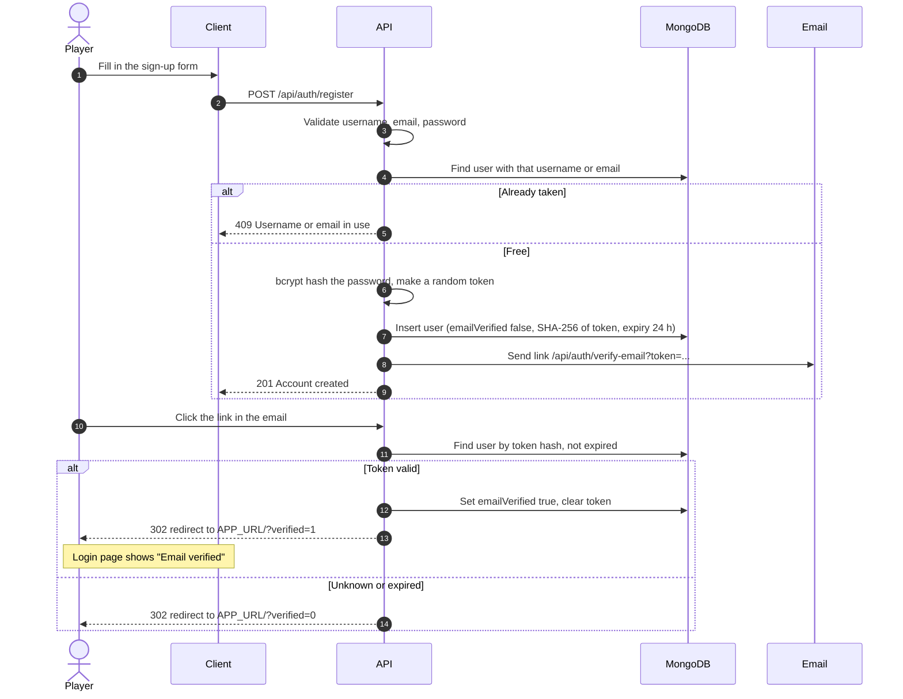
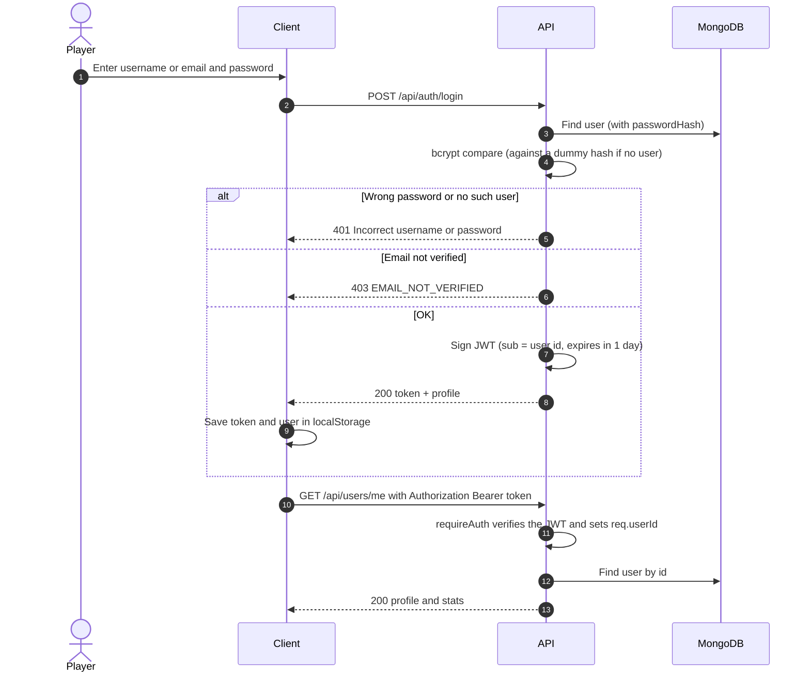
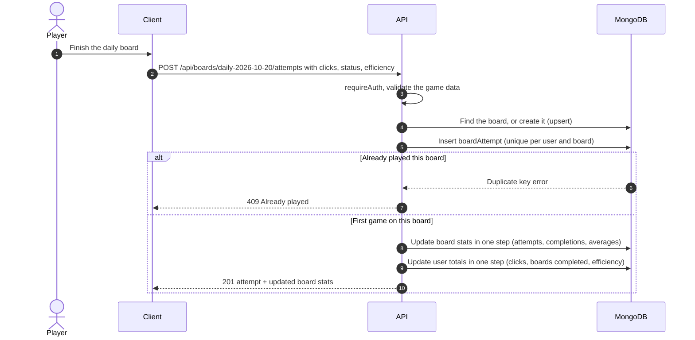
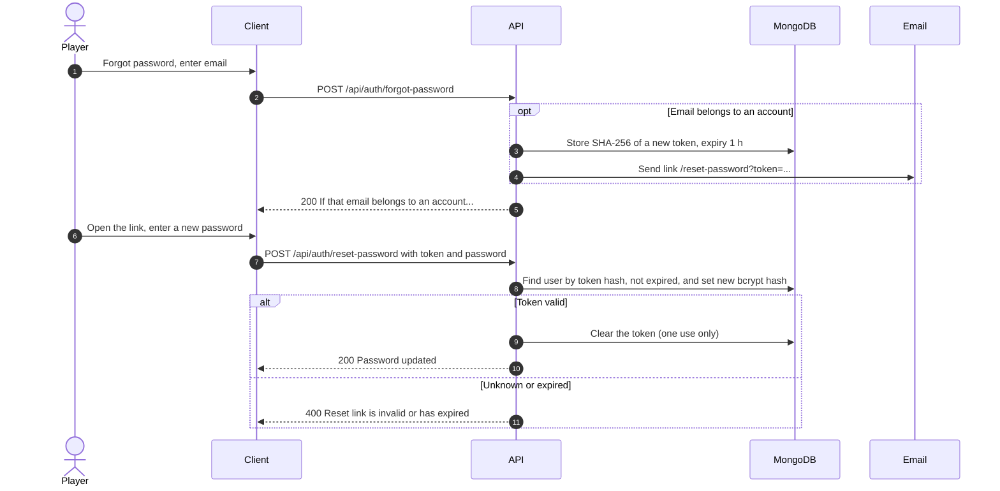
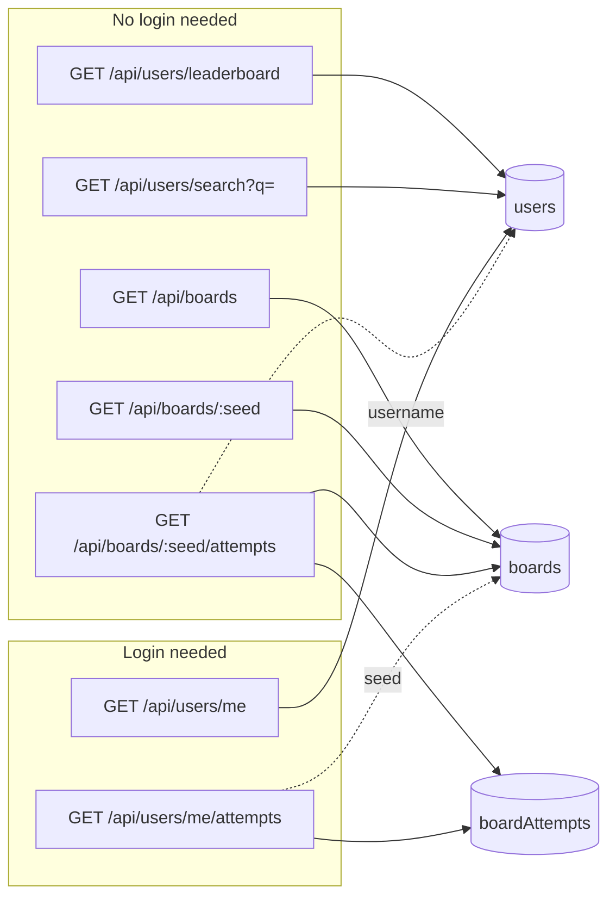
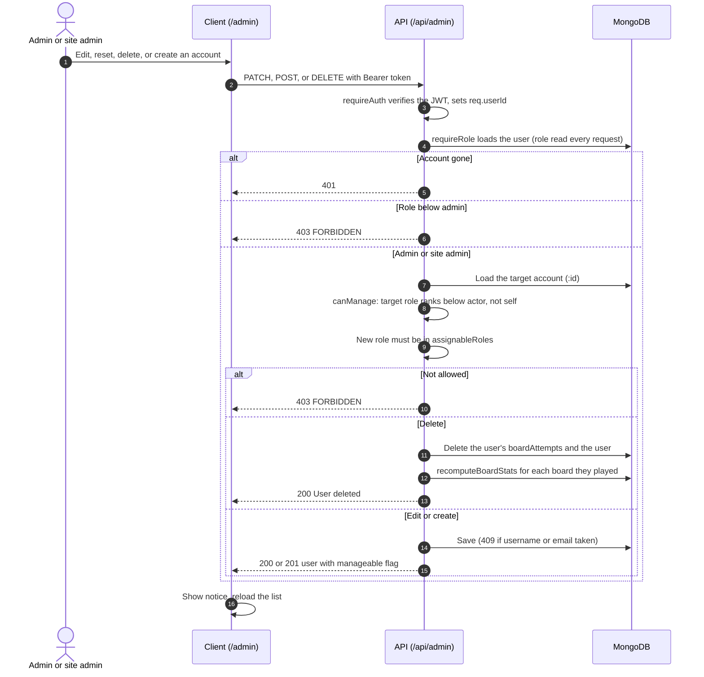
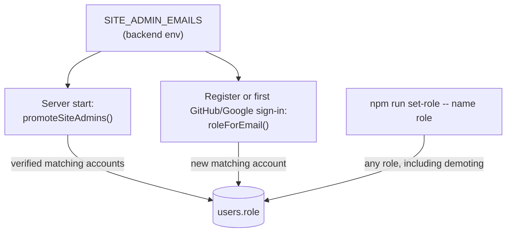

# Data flow

How data moves through the app for each main feature. Every request from the browser goes to the Vite server, which forwards `/api/*` to the backend; the diagrams show that hop as "Client". The mobile app, SwaggerHub, and the Bruno collection call the same endpoints directly.

The endpoints are described in full in [backend/openapi.yaml](../backend/openapi.yaml).

## Overview

## Sign up and email verification

Players can also sign up and log in with GitHub or Google; that flow is in [oauth.md](oauth.md).

`POST /api/auth/resend-verification` replaces the token and sends a new link. It answers the same way whether or not the email is registered.

## Log in and authenticated requests

## Recording a game

The stats updates are MongoDB update pipelines that read the old values and write the new ones in a single operation, so two games finishing at the same moment cannot overwrite each other's totals. Efficiency averages only count games that were won.

## Password reset

## Reading stats

Public endpoints never return email addresses or password hashes.

## Admin actions

Admins and site admins manage accounts from `/admin`. Roles and permissions are described in [admin.md](admin.md). Every `/api/admin` request takes this path:

Creating an account without a password, or choosing "Reset password", stores a reset token and emails the same link as "forgot password".

### Bootstrapping a site admin

An unverified account that matches is not promoted at startup, and a new one still has to verify its email before it can log in. Removing an email from the list does not demote that account; use `npm run set-role -- <username> user`.
