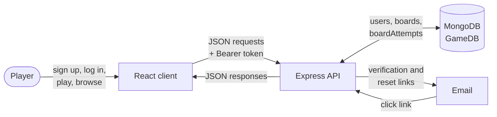
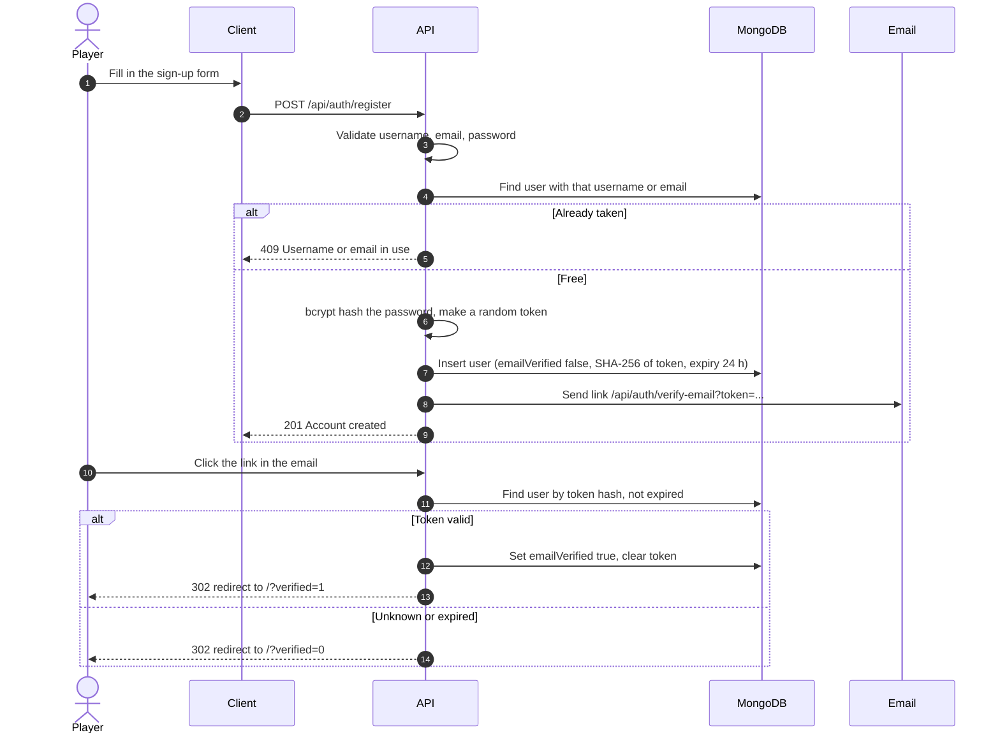
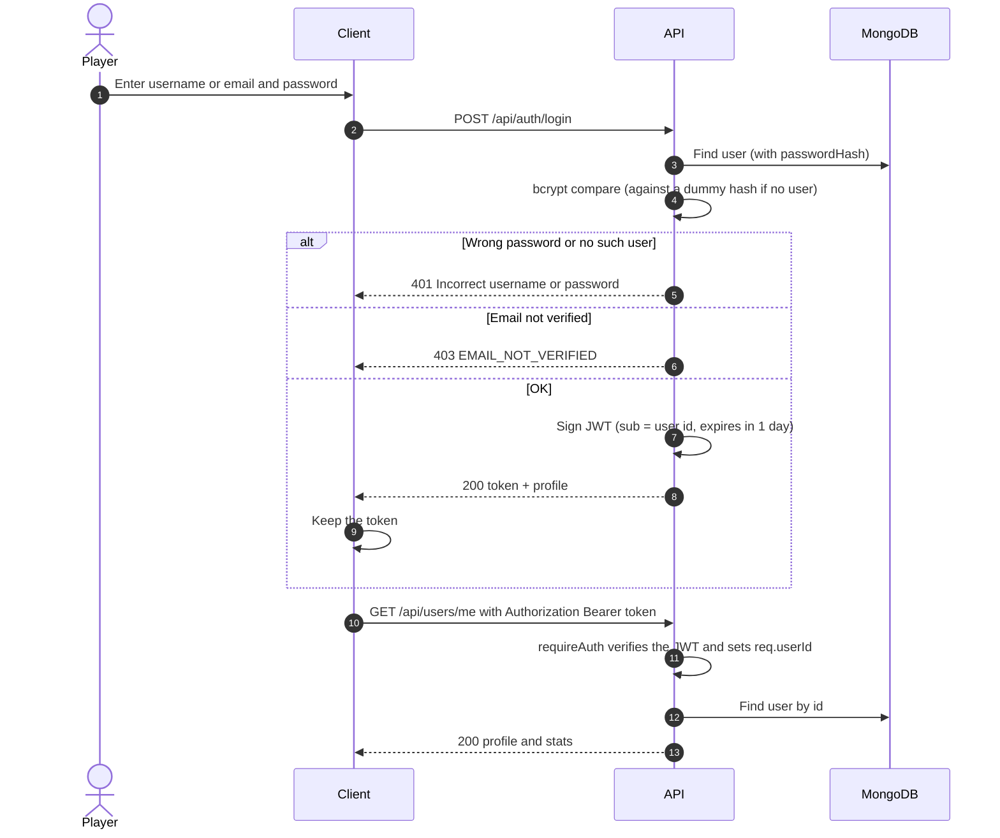
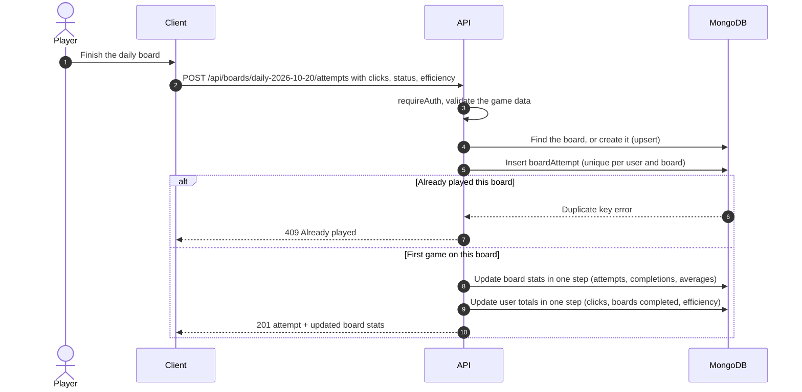
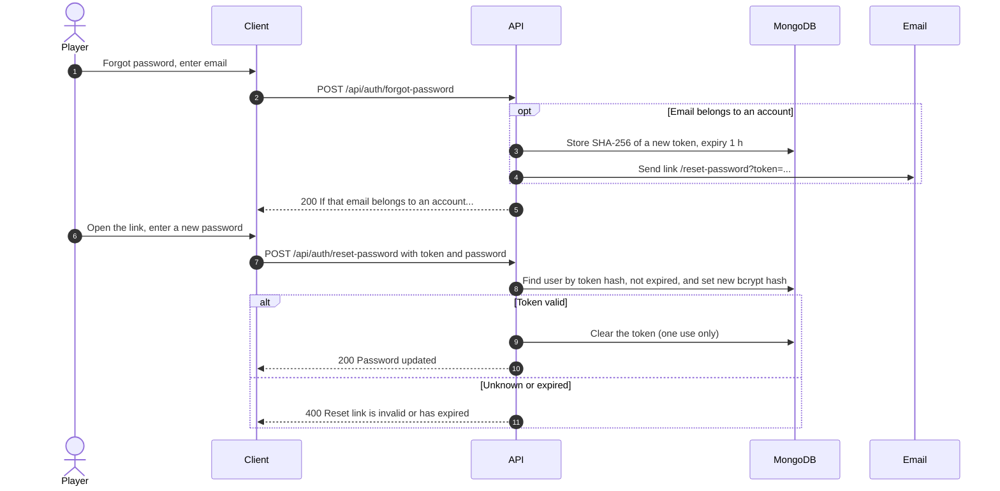
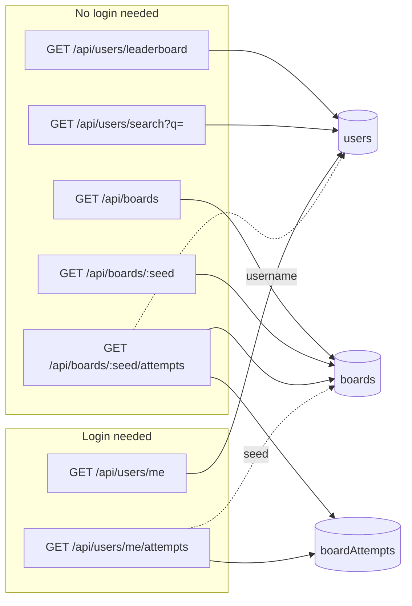

# Data flow

How data moves through the app for each main feature. Every request from the browser goes to the Vite server, which forwards `/api/*` to the backend; the diagrams show that hop as "Client". The mobile app and SwaggerHub call the same endpoints directly.

The endpoints are described in full in [backend/openapi.yaml](../backend/openapi.yaml).

## Overview

## Sign up and email verification

`POST /api/auth/resend-verification` replaces the token and sends a new link. It answers the same way whether or not the email is registered.

## Log in and authenticated requests

## Recording a game

The stats updates are MongoDB update pipelines that read the old values and write the new ones in a single operation, so two games finishing at the same moment cannot overwrite each other's totals. Efficiency averages only count games that were won.

## Password reset

## Reading stats

Public endpoints never return email addresses or password hashes.
