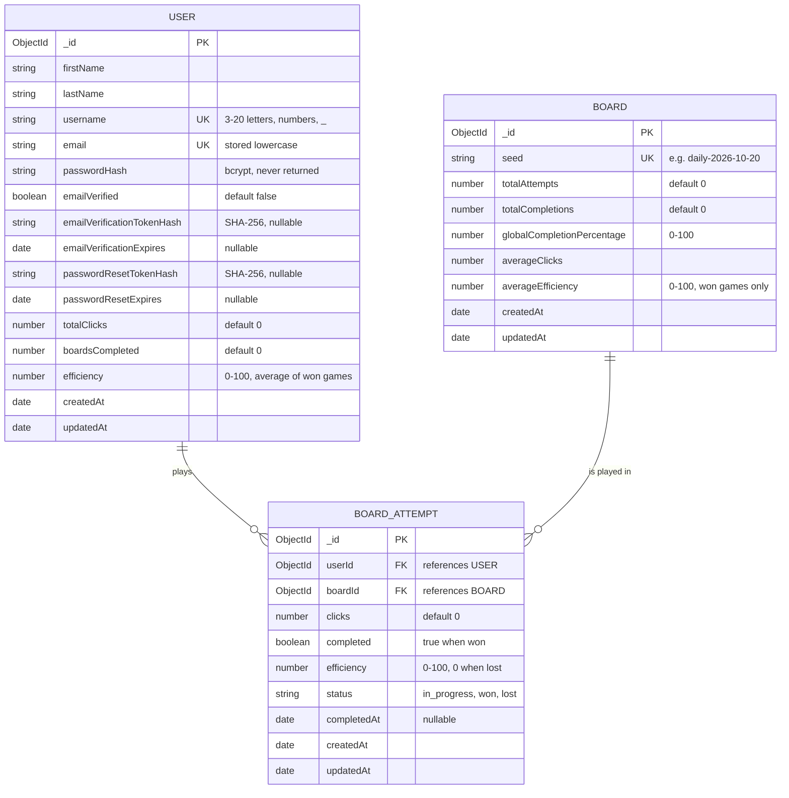

# Entity relationship diagram

The `GameDB` database has three collections. They are defined by the Mongoose models in [backend/models/](../backend/models/) and created, with their indexes, by [mongo/init/01-create-schema.js](../mongo/init/01-create-schema.js).

## Relationships and rules

| Relationship | Meaning |
| --- | --- |
| User to BoardAttempt | One user has zero or more attempts. |
| Board to BoardAttempt | One board has zero or more attempts. |
| User and Board, through BoardAttempt | Many to many. A unique index on (`userId`, `boardId`) allows one attempt per user per board. |

## Indexes

| Collection | Index | Type |
| --- | --- | --- |
| `users` | `username` | unique |
| `users` | `email` | unique |
| `boards` | `seed` | unique |
| `boardAttempts` | `userId` + `boardId` | unique, compound |

## Derived fields

The stats on `users` and `boards` are kept up to date when a game is recorded (`POST /api/boards/:seed/attempts`), rather than computed on each read:

- `boards.totalAttempts`, `totalCompletions`, `globalCompletionPercentage`, `averageClicks`, and `averageEfficiency` summarize that board's attempts.
- `users.totalClicks`, `boardsCompleted`, and `efficiency` summarize that user's attempts.

The fields holding password and token hashes are excluded from queries by default (`select: false`) and are never sent to clients.
