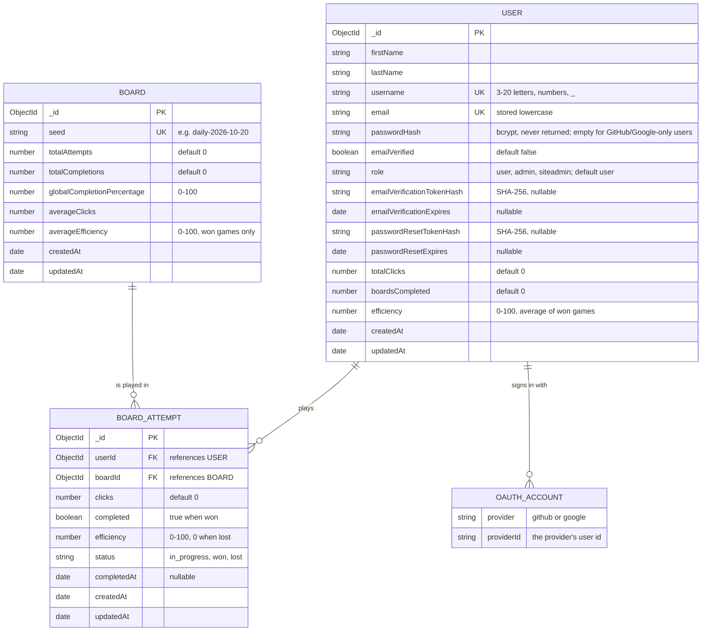

# Entity relationship diagram

The `GameDB` database has three collections. They are defined by the Mongoose models in [backend/models/](../backend/models/) and created, with their indexes, by [mongo/init/01-create-schema.js](../mongo/init/01-create-schema.js).

## Relationships and rules

| Relationship | Meaning |
| --- | --- |
| User to BoardAttempt | One user has zero or more attempts. |
| User to OAuthAccount | One user has zero or more linked GitHub or Google accounts. They are embedded in the user document as `oauthAccounts`, not a separate collection. |
| Board to BoardAttempt | One board has zero or more attempts. |
| User and Board, through BoardAttempt | Many to many. A unique index on (`userId`, `boardId`) allows one attempt per user per board. |

### Roles

`users.role` decides what an account may do on the admin dashboard. Roles rank `user` < `admin` < `siteadmin`, and an account can manage only accounts that rank below it, never its own.

| Role | Can manage | Can assign |
| --- | --- | --- |
| `user` | nothing | nothing |
| `admin` | `user` accounts | `user` |
| `siteadmin` | `user` and `admin` accounts | `user`, `admin` |

No API route assigns `siteadmin`. It comes from the `SITE_ADMIN_EMAILS` env var or `npm run set-role`. Documents created before roles existed have no `role` field and count as `user`. See [admin.md](admin.md).

## Indexes

| Collection | Index | Type |
| --- | --- | --- |
| `users` | `username` | unique |
| `users` | `email` | unique |
| `users` | `oauthAccounts.provider` + `oauthAccounts.providerId` | unique, compound, only users with linked accounts |
| `users` | `role` | regular, for the admin dashboard's role filter |
| `boards` | `seed` | unique |
| `boardAttempts` | `userId` + `boardId` | unique, compound |

## Derived fields

The stats on `users` and `boards` are kept up to date when a game is recorded (`POST /api/boards/:seed/attempts`), rather than computed on each read:

- `boards.totalAttempts`, `totalCompletions`, `globalCompletionPercentage`, `averageClicks`, and `averageEfficiency` summarize that board's attempts.
- `users.totalClicks`, `boardsCompleted`, and `efficiency` summarize that user's attempts.

When attempts are removed any other way, the totals are rebuilt from the remaining finished attempts by [backend/lib/stats.js](../backend/lib/stats.js). `recomputeBoardStats` handles boards and `recomputeUserStats` handles users. Deleting a user from the admin dashboard (`DELETE /api/admin/users/:id`) deletes their attempts, then recomputes every board they played.

The fields holding password and token hashes are excluded from queries by default (`select: false`) and are never sent to clients.
