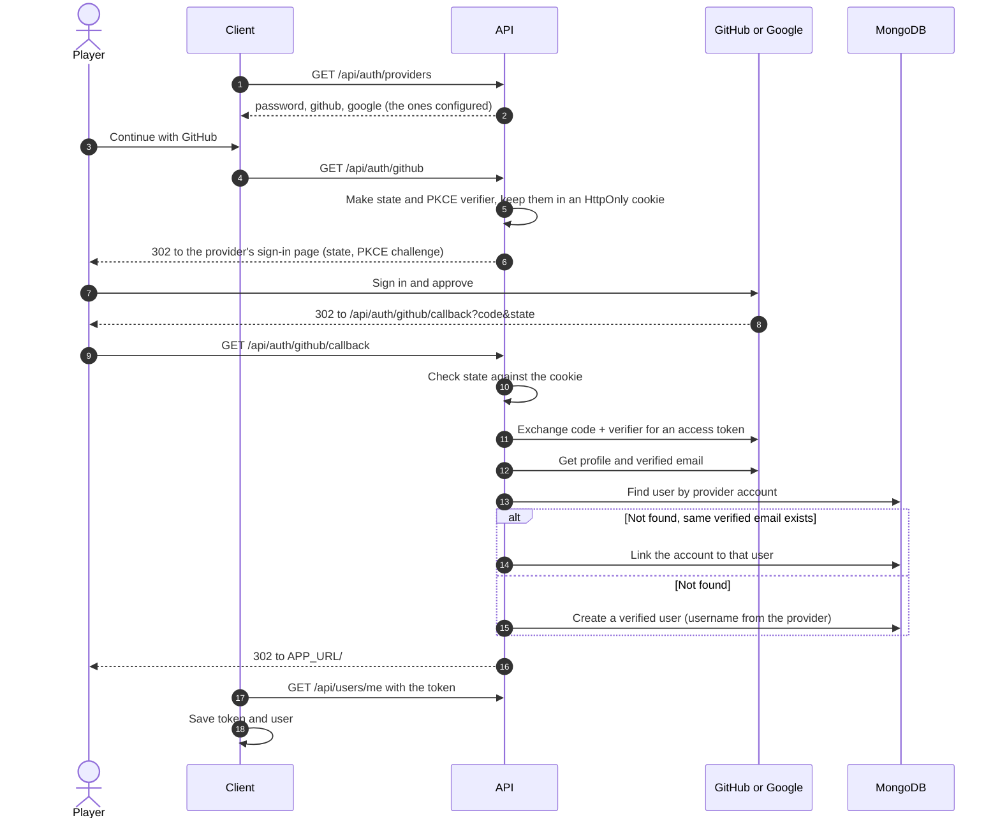

# Sign in with GitHub and Google

Players can sign in three ways: email and password, GitHub, or Google. GitHub and Google share one OAuth 2.0 flow ([backend/lib/oauth.js](../backend/lib/oauth.js) and [backend/routes/oauth.js](../backend/routes/oauth.js)); each is a short entry in a provider table and is turned on by setting its client ID and secret. A provider without both is hidden from the login page and its routes return `404`, so the app works with none configured.

## Flow



- The login token is put in the URL **fragment**, which browsers do not send to servers, so it stays out of logs. The client removes it from the address bar right away.
- Errors go back to the site as `?oauthError=` with `cancelled` (the player pressed Cancel), `state` (expired or forged), `provider` (the provider could not be reached), or `email` (no verified email).
- An existing email and password account with the same email is linked rather than duplicated (the provider must report the email as verified). If that account had already verified its email, its password keeps working. If it had not, its password is removed: whoever set it never proved they own the address, and keeping it would let someone register a victim's email in advance and take over the account once the victim signs in with a provider. Users who signed up with a provider have no password; they can set one with "forgot password".
- Usernames come from the GitHub login or the part of the Google email before `@`, changed to fit the 3-20 letters, numbers, or `_` rule, with digits added if taken.

## Setup

Set these in `.env` (never commit the secrets), then run `docker compose up -d backend`:

```bash
GITHUB_CLIENT_ID=
GITHUB_CLIENT_SECRET=
GOOGLE_CLIENT_ID=
GOOGLE_CLIENT_SECRET=
```

The callback URLs are built from `APP_URL`, so they must match it exactly.

### GitHub

GitHub → Settings → Developer settings → **OAuth Apps** → New OAuth App (not a GitHub App). An OAuth App has one callback URL, so make one per environment:

| Field | Local | Production |
| --- | --- | --- |
| Homepage URL | `http://localhost:5173` | `https://sweeple.natreese.dev` |
| Authorization callback URL | `http://localhost:5173/api/auth/github/callback` | `https://sweeple.natreese.dev/api/auth/github/callback` |

Copy the Client ID, then **Generate a new client secret** (shown once).

### Google

Google Cloud Console → APIs & Services:

1. **OAuth consent screen**: app name, support email, scopes `openid`, `email`, `profile`. While the app is in *Testing*, only the Google accounts listed as **test users** can sign in; add the team's and the GTA's.
2. **Credentials** → Create credentials → OAuth client ID → **Web application**. Add both authorized redirect URIs (one client can hold several):
   - `http://localhost:5173/api/auth/google/callback`
   - `https://sweeple.natreese.dev/api/auth/google/callback`

Google allows `http://localhost`, but other addresses must use HTTPS.

## Data

Linked accounts are stored on the user as `oauthAccounts: [{ provider, providerId }]`, with a unique index so a GitHub or Google account belongs to at most one user. See [erd.md](erd.md).
