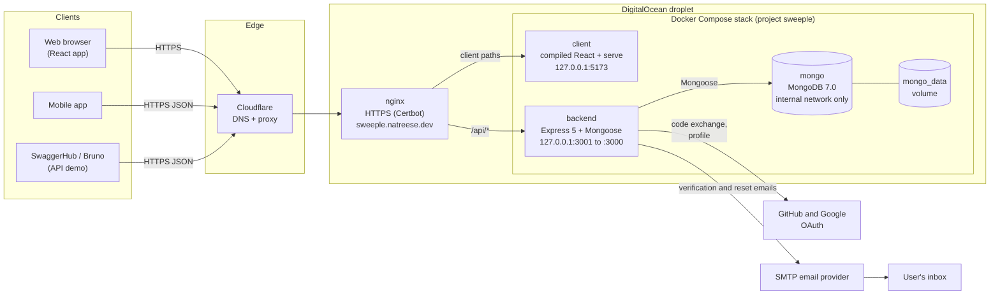
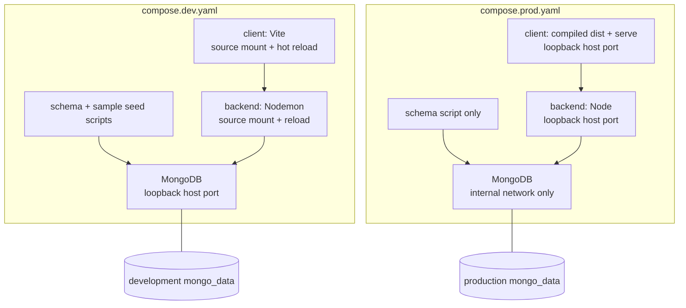
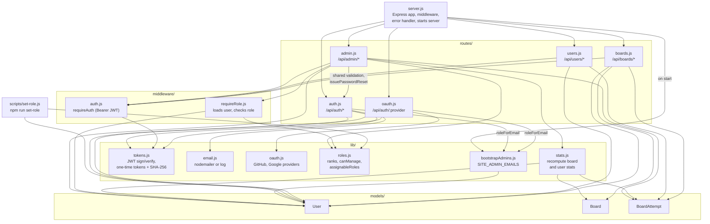
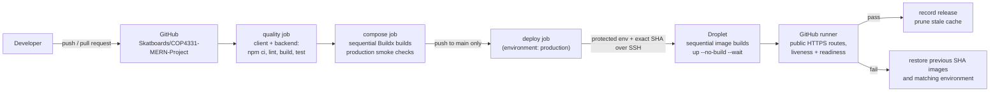

# System design

Sweeple is a MERN app with a React client, an Express API, and MongoDB.
[`compose.dev.yaml`](../compose.dev.yaml) provides the source-mounted local
development environment; [`compose.prod.yaml`](../compose.prod.yaml) defines
the optimized, loopback-bound production stack. The two environments are
explicit rather than layered on a shared default Compose file.

## Deployment overview

How a request reaches the app in production, and how code gets there.

- Only the separately managed host Nginx service is reachable from the internet. The client and backend host ports listen on `127.0.0.1`; MongoDB has no production host port.
- The production client is still a container, but it runs the locked `serve` static-server dependency rather than Vite or an embedded Nginx process.
- Host Nginx terminates HTTPS, sends client paths to the client container, and sends `/api/*` directly to the backend container. Deployment verifies this routing but does not modify Nginx.
- Without `SMTP_HOST`, the backend prints emails to its log instead of sending them.

## Containers

Both stacks order services with health checks. Development uses process
liveness for the backend; production uses `GET /api/health/ready`, which
performs a bounded MongoDB ping and briefly caches the generic result. The
production database excludes sample seed data.

## Backend modules

## Continuous integration and deployment

The backend tests use an in-memory MongoDB. CI builds Docker images in explicit
sequential steps with separate Buildx cache scopes. Pull requests stop after
quality and Compose verification. A successful push deploys the exact commit
tested by that run, transfers a mode-`0600` release-specific environment, and
retains the previous successful images and configuration until public checks
pass. `DROPLET_USER` and `DROPLET_APP_PATH` are GitHub environment secrets.
