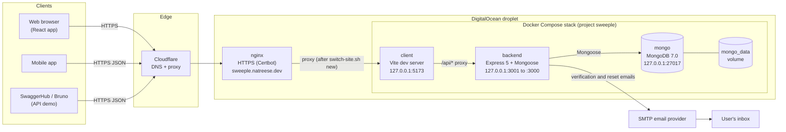
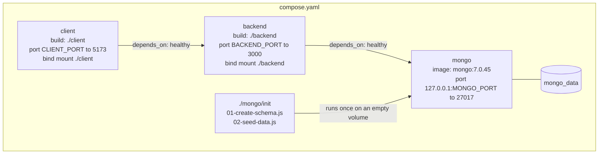
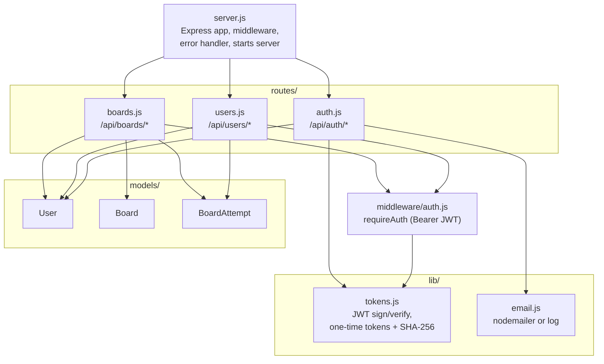
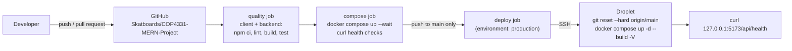

# System design

Sweeple is a MERN app: a React client, an Express API, and MongoDB, each in its own container from [compose.yaml](../compose.yaml). The same Compose stack runs locally and on the DigitalOcean droplet.

## Deployment overview

How a request reaches the app in production, and how code gets there.

- Only nginx is reachable from the internet. The containers listen on `127.0.0.1`.
- The Vite server serves the React app and forwards every `/api/*` request to the `backend` service, so the browser only ever talks to one origin.
- nginx still sends the domain to the older pm2 app until `deploy/switch-site.sh new` is run (see [deploy/README.md](../deploy/README.md)).
- Without `SMTP_HOST`, the backend prints emails to its log instead of sending them.

## Containers

Each service has a health check (`GET /` for the client, `GET /api/health` for the backend, a `ping` for MongoDB), and Compose starts them in order once the one before is healthy.

## Backend modules

## Continuous integration and deployment

The backend `test` step runs the API tests against an in-memory MongoDB, so it needs no database service. Pull requests run the first two jobs only.
